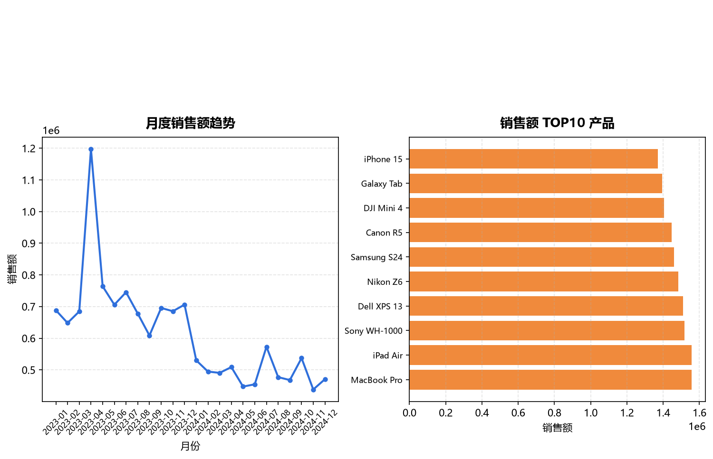
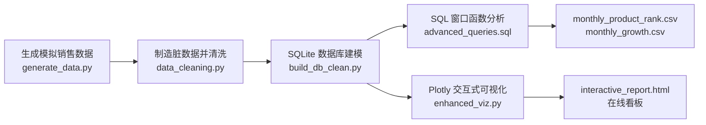

# Sales-Analytics-Portfolio

**零售销售数据自动化分析管道** · *Retail Sales Analytics Pipeline (End-to-End)*




## 项目简介

本项目独立构建了一套完整的零售销售分析 Pipeline，覆盖 **数据生成 → 质量治理 → 数据库建模 → 进阶指标计算 → 交互式报告产出** 全流程。项目既能展示工程化能力，也演示了数据清洗与 SQL 窗口函数的实际应用。

*A self-contained retail sales analytics pipeline: from synthetic data generation, dirty-data injection & cleaning, SQLite modeling, window-function metrics, to interactive reporting.*

## ✨ 核心亮点

- **数据治理**：主动构造缺失值、负值、重复 ID、异常日期四类脏数据，采用中位数填充、去重与日期修正策略完成清洗。
- **进阶分析**：运用 `ROW_NUMBER` 与 `LAG` 窗口函数，实现「月度产品排名 TOP3」与「月度销售额环比增长」计算。
- **工程化**：编写一键运行脚本 `run.py`，实现从数据到报告的自动化闭环。

## 🧭 分析流程



## 🖥️ 在线看板

👉 [点击查看交互式销售看板](https://3289848412.github.io/Sales-Analytics-Portfolio/outputs/interactive_report.html)

（上方配图为静态预览，在线看板为可交互的 Plotly 图表，支持缩放、悬停查看数值。）

## 🛠 技术栈

| 组件 | 用途 |
| --- | --- |
| Python | 全流程脚本与调度 |
| Pandas | 数据生成、清洗与聚合 |
| SQLite | 本地数据库建模 |
| SQL 窗口函数 | 月度排名（ROW_NUMBER）与环比增长（LAG） |
| Matplotlib | 静态报告图表 |
| Plotly | 交互式可视化看板 |

## 📁 项目结构

```
Sales-Analytics-Portfolio
├── run.py                        # 一键运行入口
├── generate_data.py              # 生成模拟销售数据
├── requirements.txt              # 依赖清单
├── src/
│   ├── data_cleaning.py          # 制造脏数据 → 清洗
│   ├── build_db_clean.py         # 基于清洗数据重建 SQLite
│   ├── enhanced_viz.py           # 生成 Plotly 交互式报告
│   ├── advanced_queries.sql      # SQL 窗口函数（排名 / 环比）
│   ├── advanced_analysis.py      # 执行窗口函数并导出 CSV
│   ├── original_build_db.py      # 原始版本：建库
│   └── original_viz.py           # 原始版本：静态图
├── data/
│   ├── sales.csv                 # 模拟原始数据
│   ├── sales.db                  # 原始库
│   ├── sales_clean.db            # 清洗后库
│   ├── raw/sales_raw.csv         # 注入脏数据后的数据
│   └── processed/sales_clean.csv # 清洗结果
├── outputs/
│   ├── basic_report.png          # 静态报告（Matplotlib）
│   ├── interactive_report.html   # 交互式看板（Plotly）
│   ├── monthly_product_rank.csv  # 月度产品排名 TOP3
│   └── monthly_growth.csv        # 月度销售额环比增长
└── docs/images/
    └── dashboard_preview.png     # README 配图
```

## 📊 数据字段

| 字段 | 类型 | 说明 |
| --- | --- | --- |
| Order_ID | TEXT | 订单唯一编号 |
| Order_Date | TEXT (YYYY-MM-DD) | 下单日期 |
| Product | TEXT | 产品名称 |
| Category | TEXT | 产品类别 |
| Sales | REAL | 订单销售额 |
| Quantity | INTEGER | 购买数量 |

## 🚀 本地运行

**前置条件**：Python 3.9+。

```bash
# 1. 安装依赖
pip install -r requirements.txt

# 2. 一键运行全流程
python run.py
```

运行后会自动完成「生成数据 → 造脏数据 → 清洗 → 建库 → SQL 窗口函数 → 可视化」，并产出：

- `outputs/basic_report.png`：静态报告
- `outputs/interactive_report.html`：交互式看板（浏览器打开即可查看）
- `outputs/monthly_product_rank.csv`：月度产品排名 TOP3
- `outputs/monthly_growth.csv`：月度销售额环比增长

## 📌 SQL 窗口函数示例

**月度产品排名 TOP3（`ROW_NUMBER`）**

```sql
WITH monthly_rank AS (
    SELECT
        Product,
        strftime('%Y-%m', Order_Date) AS month,
        SUM(Sales) AS total_sales,
        ROW_NUMBER() OVER (
            PARTITION BY strftime('%Y-%m', Order_Date)
            ORDER BY SUM(Sales) DESC
        ) AS rn
    FROM sales
    GROUP BY Product, month
)
SELECT month, Product, total_sales
FROM monthly_rank
WHERE rn <= 3
ORDER BY month ASC, total_sales DESC;
```

**月度销售额环比增长（`LAG`）**

```sql
WITH monthly_total AS (
    SELECT
        strftime('%Y-%m', Order_Date) AS month,
        SUM(Sales) AS current_month_sales
    FROM sales
    GROUP BY month
)
SELECT
    month,
    current_month_sales,
    LAG(current_month_sales, 1) OVER (ORDER BY month) AS prev_month_sales,
    ROUND(
        (current_month_sales - LAG(current_month_sales, 1) OVER (ORDER BY month))
        / LAG(current_month_sales, 1) OVER (ORDER BY month) * 100, 2
    ) || '%' AS growth_rate
FROM monthly_total
ORDER BY month ASC;
```

以上 SQL 已通过 `src/advanced_analysis.py` 接入 `run.py`，运行后结果会导出为 CSV。
